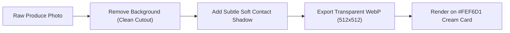
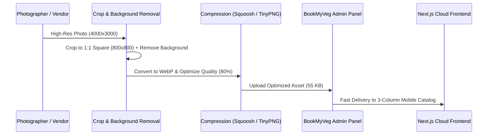

# BookMyVeg Image Style & Optimization Guide

A comprehensive manual for photography, catalog uploads, category visuals, and promotional assets across the **BookMyVeg** web and mobile platforms.

---

## 1. Executive Summary & Design Principles

BookMyVeg relies on high-speed, appetizing, clean visuals that make farm-fresh produce look pristine and instantly identifiable—even on compact **3-column mobile catalog cards**.

### Core Visual Pillars:
1. **Fresh & Natural**: Colors must reflect real farm freshness. Avoid unnatural over-saturation, synthetic glows, or artificial tinting.
2. **Instant Legibility**: On mobile screens (where each product card is ~110px wide), the vegetable or fruit must be clearly identifiable at a glance.
3. **Clean Isolation**: Produce should be placed on seamless studio white or transparent backgrounds with subtle ground contact shadows. Never use cluttered kitchen tables or chaotic market backgrounds.
4. **Lightweight & Fast**: Quick-commerce demands near-instant load times. All images must follow strict file-size budgets.

---

## 2. Product Catalog Images (3-Column Mobile Grid & Product Detail)

All catalog items must adhere strictly to these dimensions to maintain alignment in the 3-column mobile layout.

| Parameter | Specification | Notes |
| :--- | :--- | :--- |
| **Aspect Ratio** | `1:1` (Exact Square) | Required for consistent card rendering |
| **Resolution** | `600 × 600 px` (Standard)<br>`800 × 800 px` (Max high-res) | Avoid anything larger than `1000 × 1000 px` |
| **Canvas Padding** | 10% – 15% margin on all sides | The product should fill **80% to 85%** of the canvas |
| **Background** | **Pure Studio White (`#FFFFFF`)** or **Transparent (PNG / WebP)** | No gradients, no dark backdrops |
| **Perspective Angle** | `30°` to `45°` elevated angle or direct eye-level | Showcases volume, texture, and natural shape |
| **File Format** | **WebP** (Recommended) or **JPEG** | WebP saves ~30% file size at identical quality |
| **File Size Budget** | **40 KB – 80 KB** per image | Never upload raw multi-megabyte camera photos |

### Visual Examples & Produce Types:

* **Leafy Vegetables (Spinach, Methi, Coriander)**:
  * Crisp, upright bunches bound cleanly with twine or rubber band.
  * Free of wilting, yellow leaves, or heavy water droplets that look soggy.
* **Bulk Root Vegetables (Potato, Onion, Ginger)**:
  * Clean, dry, and free of clotted mud or dark bruising.
  * Show a tight cluster (e.g. 3–4 potatoes grouped neatly) rather than an unmanageable pile.
* **Packaged Goods (Spices, Multigrain Atta, Ghee, Dairy)**:
  * Straight-on shot of packaging facing the camera with brand and weight clearly readable.
  * Glare-free plastic/glass reflection.

---

## 3. Category Tile Visuals (4×3 Grid on `#FEF6D1` Cream Background)

Categories on the BookMyVeg homepage and `/categories` page live inside custom warm cream cards (`#FEF6D1`).



| Parameter | Specification |
| :--- | :--- |
| **Canvas & Ratio** | `1:1` Square (`400 × 400 px` or `512 × 512 px`) |
| **Background** | **100% Transparent PNG or WebP** (Mandatory so `#FEF6D1` shows through) |
| **Style** | 3D cutout, claymorphic render, or clean isolated real-food collage |
| **Shadow** | Gentle, diffused ground contact shadow (`drop-shadow-sm`) right at the base |
| **File Size Budget** | **20 KB – 50 KB** |

---

## 4. Hero Banners & Promotional Sliders

Used on the homepage promotional carousel and seasonal campaigns.

| Parameter | Desktop / Tablet | Mobile App / PWA |
| :--- | :--- | :--- |
| **Dimensions** | `1200 × 500 px` (`2.4 : 1`) | `800 × 340 px` (`2.35 : 1`) |
| **Safe Zone** | Keep text & CTA buttons within the center `70%` | Leave 24px margin from rounded device borders |
| **Palette** | BookMyVeg Emerald (`#017649`), Lemon Cream (`#FEF6D1`), Fresh Mint, Sunny Yellow | High contrast against white/dark text |
| **File Size** | Under **150 KB** (WebP) | Under **100 KB** (WebP) |

---

## 5. Technical Optimization & Next.js Rules

When rendering images in the React / Next.js frontend:

1. **Always use Next.js `<Image>` with responsive `sizes`**:
   ```tsx
   <Image
       src={product.images[0]}
       alt={product.name}
       fill
       sizes="(max-width: 600px) 33vw, (max-width: 1024px) 25vw, 200px"
       className="object-contain p-1 sm:p-2"
   />
   ```
2. **Use `object-contain`**:
   Ensures irregularly shaped fruits and bunches (bananas, carrots, cucumbers) are never stretched or clipped.
3. **Out of Stock Treatment**:
   De-emphasize sold-out products using CSS filters rather than uploading alternate gray images:
   ```tsx
   className={cn("object-contain", isOutOfStock && "opacity-40 grayscale")}
   ```

---

## 6. Image Preparation & Upload Workflow

Before uploading images in the Admin Panel (`/admin/products` or `/admin/categories`):



1. **Shoot**: Take photo under bright, daylight-balanced lighting on a neutral surface.
2. **Crop & Square**: Crop exactly to a 1:1 square canvas (`800 × 800 px`), centering the item.
3. **Cutout (If needed)**: Use tools like Photoshop, Canva Pro, or Remove.bg to isolate the item on transparent or pure `#FFFFFF`.
4. **Compress**: Run through [TinyPNG](https://tinypng.com), Squoosh.app, or sharp CLI to convert to WebP at ~80% quality. Ensure file size is **< 80 KB**.
5. **Upload**: Attach to the product record via the Admin Console.

---

## 7. Do's & Don'ts Checklist

| Do | Don't |
| :--- | :--- |
| **DO** use tight, appetizing center crops with 10% breathing room. | **DON'T** use wide-angle shots with empty table space on the sides. |
| **DO** use pure white (`#FFFFFF`) or transparent backgrounds. | **DON'T** shoot on patterned bedsheets, dirty crates, or crowded floor tiles. |
| **DO** show fresh, dry, unblemished vegetables and fruits. | **DON'T** upload bruised, overripe, or soggy produce photos. |
| **DO** ensure brand packaging labels face directly forward. | **DON'T** use tilted, skewed, or upside-down packaged shots. |
| **DO** keep files under 80 KB in WebP or PNG format. | **DON'T** upload raw 4 MB to 8 MB direct camera exports. |
| **DO** maintain consistent soft lighting across all items in a category. | **DON'T** mix harsh yellow halogen lighting with cool blue daylight. |

---

*Document Version 1.0 — BookMyVeg Brand & Catalog Guidelines*
